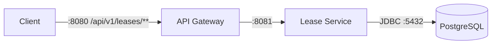

<div align="center">

# TrustLease · Backend

**A Spring Boot backend for issuing and managing resource leases.**

<br />


</div>

---

## At a glance

| | |
|---|---|
| **Runtime** | Java 21, Spring Boot 4.1.1 |
| **Build** | Maven Wrapper in each service |
| **Database** | PostgreSQL 18 via Docker Compose for the lease service |
| **API gateway** | `http://localhost:8080` |
| **Lease API** | `http://localhost:8081` |
| **Automated tests** | JUnit 6, Spring Test, Testcontainers |

## What is TrustLease?

TrustLease lets an organization give someone limited access to a resource, such as a file or service. A lease records who gets access, what they can do, and when that access expires. It can also limit how many times they use it.

It exists to make access easier to control. Instead of giving someone permanent access, an organization can issue a lease that ends on its own or runs out after a set number of uses.

**Example:** A company shares a report with a contractor. It gives them permission to read the report until Friday, with a limit of five views. TrustLease records that access so the company can manage it.

> **Project status**  
> This repository contains seven independently built services. The gateway currently routes lease API traffic, and the lease service contains the implemented HTTP endpoints. The other services are Spring Boot application scaffolds.

## Services

| Service | Purpose | Default port | Current state |
|---|---|---:|---|
| `api-gateway` | Routes `/api/v1/leases/**` to the lease service | `8080` | Lease route configured |
| `lease-service` | Creates and reads leases | `8081` | API implemented; PostgreSQL-backed |
| `identity-service` | Identity and authentication | Spring default (`8080`) | Scaffold |
| `authorization-service` | Authorization | Spring default (`8080`) | Scaffold |
| `policy-service` | Policy evaluation | Spring default (`8080`) | Scaffold |
| `audit-service` | Audit events | Spring default (`8080`) | Scaffold |
| `notification-service` | Notifications | Spring default (`8080`) | Scaffold |

Each folder is a standalone Maven project with its own `pom.xml` and Maven Wrapper. There is no root Maven aggregator yet.

## How requests flow



For local development, you can call the lease service directly on port `8081` or send requests through the gateway on port `8080`.

## Quick start

### Requirements

- Java 21
- Docker Desktop with its Linux container engine running
- PowerShell on Windows, or a POSIX shell on macOS/Linux

### 1. Start PostgreSQL

From this directory:

```powershell
docker compose -f lease-service/compose.yaml up -d
```

The local database uses the development settings in `lease-service/src/main/resources/application.properties`:

| Setting | Value |
|---|---|
| Database | `mydatabase` |
| Username | `myuser` |
| Password | `secret` |
| Host port | `5432` |

Port `5432` must be available. Check for another local PostgreSQL server if the container cannot bind that port.

### 2. Start the lease service

In a new terminal:

```powershell
cd lease-service
.\mvnw.cmd spring-boot:run
```

The service starts at <http://localhost:8081>.

### 3. Start the gateway (optional)

In another terminal:

```powershell
cd api-gateway
.\mvnw.cmd spring-boot:run
```

The gateway starts at <http://localhost:8080> and forwards configured lease routes to port `8081`.

<details>
<summary><strong>macOS / Linux commands</strong></summary>

In separate terminals:

```bash
docker compose -f lease-service/compose.yaml up -d
cd lease-service
./mvnw spring-boot:run
```

Optional gateway, in another terminal:

```bash
cd api-gateway
./mvnw spring-boot:run
```

</details>

## Lease API

Base path: `/api/v1/leases`

| Method | Path | Description |
|---|---|---|
| `GET` | `/api/v1/leases/health` | Service health |
| `GET` | `/api/v1/leases/` | List leases (page and size are supported) |
| `GET` | `/api/v1/leases/{id}` | Get a lease by ID |
| `POST` | `/api/v1/leases/` | Create a lease; returns `201 Created` |

### Create a lease

The create endpoint binds **form fields** (`application/x-www-form-urlencoded`). `expiresAt` must be an ISO-8601 instant. Permissions are enum values: `READ`, `DOWNLOAD`, `UPDATE`, or `DELETE`.

```bash
curl -X POST http://localhost:8080/api/v1/leases/ \
  -H "Content-Type: application/x-www-form-urlencoded" \
  --data-urlencode "orgId=7" \
  --data-urlencode "resourceId=101" \
  --data-urlencode "subjectId=201" \
  --data-urlencode "permissions=READ" \
  --data-urlencode "expiresAt=2030-01-01T00:00:00Z" \
  --data-urlencode "maxUses=10"
```

Required positive values: `orgId`, `subjectId`, and `maxUses`. `resourceId` is optional. The endpoint accepts the same request when sent directly to port `8081`.

Health check:

```bash
curl http://localhost:8080/api/v1/leases/health
```

Expected response:

```json
{
  "status": "UP",
  "service": "lease-service"
}
```

## Run tests

Tests for each service run from that service's folder. For the lease service:

```powershell
cd lease-service
mvn -Dtest=LeaseApiTests test
```

Or use the included wrapper if Maven is not installed:

```powershell
.\mvnw.cmd -Dtest=LeaseApiTests test
```

The lease API tests start an isolated PostgreSQL container with Testcontainers. Docker Desktop must be running; the tests do not use the local development database on port `5432`.

To run all tests in the lease service, omit the test filter:

```powershell
.\mvnw.cmd test
```

## Configuration and local data

The lease service's current local configuration is in `lease-service/src/main/resources/application.properties`. Spring Boot can also start its Compose dependency when the service runs, because the Docker Compose integration is included in the project.

> **Local database warning**  
> Hibernate is configured with `spring.jpa.hibernate.ddl-auto=create`. Starting the lease service recreates its schema and can erase existing lease data. Use disposable development data only with this setting.

The credentials in the checked-in properties and Compose file are for local development. Do not reuse them for a deployed environment.

## Repository layout

```text
backend/
├── api-gateway/
├── audit-service/
├── authorization-service/
├── identity-service/
├── lease-service/
│   ├── compose.yaml
│   ├── pom.xml
│   └── src/
├── notification-service/
└── policy-service/
```

## Troubleshooting

<details>
<summary><strong>PostgreSQL reports password authentication failed</strong></summary>

Confirm the app is reaching the Compose database on port `5432`, and that its settings match:

```text
Database: mydatabase
Username: myuser
Password: secret
```

An already initialized PostgreSQL data directory keeps its existing role password; changing `POSTGRES_PASSWORD` in Compose does not update that existing role.

</details>

<details>
<summary><strong>Port 5432 is already in use</strong></summary>

Find and stop the PostgreSQL server that owns the port, or configure both the Compose host port and the Spring JDBC URL to use the same available port. The checked-in defaults use `5432`.

</details>

<details>
<summary><strong>Testcontainers cannot find Docker</strong></summary>

Start Docker Desktop and confirm it is using the Linux container engine. Then rerun the Maven test command.

</details>

